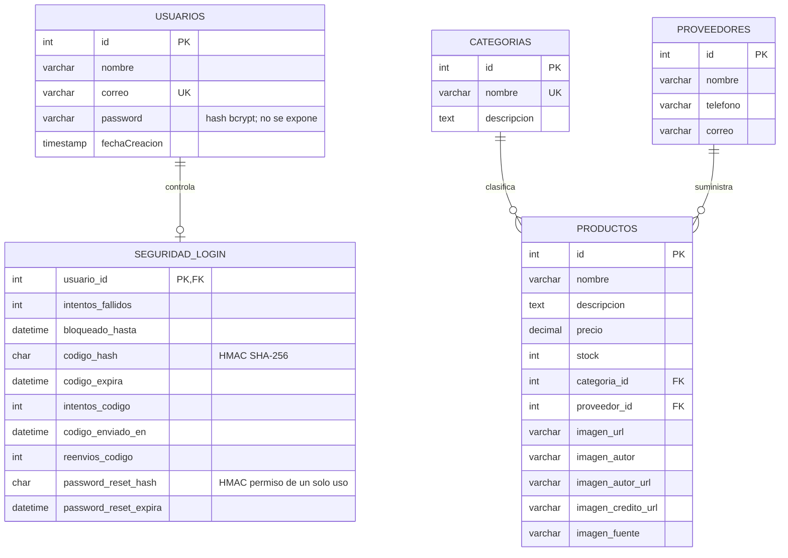

# Modelo de datos

Base: `inventario_empresa`. Se usan tablas InnoDB, claves primarias autoincrementales e integridad referencial. Los campos opcionales aceptan `NULL`.

| Entidad | Atributo | Tipo SQL | Regla |
|---|---|---|---|
| Usuario | id | INT UNSIGNED | PK, autoincremental |
| Usuario | nombre | VARCHAR(100) | Obligatorio |
| Usuario | correo | VARCHAR(150) | Obligatorio, único y normalizado a minúsculas |
| Usuario | password | VARCHAR(255) | Obligatorio, contiene solo hash bcrypt |
| Usuario | fechaCreacion | TIMESTAMP | DEFAULT CURRENT_TIMESTAMP |
| Seguridad de login | usuario_id | INT UNSIGNED | PK y FK a Usuario, borrado en cascada |
| Seguridad de login | intentos_fallidos | TINYINT UNSIGNED | 0 por defecto; bloquea al quinto intento |
| Seguridad de login | bloqueado_hasta | DATETIME | Límite del bloqueo temporal de 15 minutos |
| Seguridad de login | codigo_hash | CHAR(64) | HMAC-SHA256 del código; nunca guarda el código claro |
| Seguridad de login | codigo_expira | DATETIME | Vence 10 minutos después de emitir el código |
| Seguridad de login | intentos_codigo | TINYINT UNSIGNED | Máximo 5 verificaciones por código |
| Seguridad de login | codigo_enviado_en | DATETIME | Momento del último envío; impone 60 segundos entre códigos |
| Seguridad de login | reenvios_codigo | TINYINT UNSIGNED | Máximo 3 reenvíos por bloqueo |
| Seguridad de login | password_reset_hash | CHAR(64) | HMAC de permiso temporal de cambio; un solo uso |
| Seguridad de login | password_reset_expira | DATETIME | El permiso de cambio vence en 10 minutos |
| Categoría | id | INT UNSIGNED | PK, autoincremental |
| Categoría | nombre | VARCHAR(100) | Obligatorio, único |
| Categoría | descripcion | TEXT | Opcional |
| Proveedor | id | INT UNSIGNED | PK, autoincremental |
| Proveedor | nombre | VARCHAR(150) | Obligatorio, único en instalaciones nuevas |
| Proveedor | telefono | VARCHAR(20) | Opcional |
| Proveedor | correo | VARCHAR(150) | Opcional |
| Producto | id | INT UNSIGNED | PK, autoincremental |
| Producto | nombre | VARCHAR(150) | Obligatorio |
| Producto | descripcion | TEXT | Opcional |
| Producto | precio | DECIMAL(10,2) | Obligatorio, no negativo; precio ficticio de muestra |
| Producto | stock | INT | Obligatorio, no negativo; existencia de muestra |
| Producto | categoria_id | INT UNSIGNED | FK a `categorias.id`, obligatorio |
| Producto | proveedor_id | INT UNSIGNED | FK a `proveedores.id`, obligatorio |
| Producto | imagen_url | VARCHAR(2048) | Opcional, URL HTTPS directa |
| Producto | imagen_autor | VARCHAR(200) | Opcional, crédito visible |
| Producto | imagen_autor_url | VARCHAR(2048) | Opcional, perfil del fotógrafo |
| Producto | imagen_credito_url | VARCHAR(2048) | Opcional, enlace de la foto/fuente |
| Producto | imagen_fuente | VARCHAR(100) | Opcional, Unsplash u otra publicación |

Una categoría puede clasificar varios productos, y cada producto referencia una categoría. Un proveedor puede suministrar varios productos, y cada producto referencia un proveedor. `ON DELETE RESTRICT` impide borrar categorías o proveedores con productos asociados. La base de datos guarda las URL y atribuciones de imagen elegidas, nunca copia la fotografía.

La vista pública es un catálogo académico, no una tienda transaccional. Los datos de muestra son ficticios. Cada uno de los 15 registros de demostración tiene una ilustración vectorial local específica, indicada como ilustración y no fotografía del artículo. No se consultó Unsplash para generar estas imágenes. Si un registro nuevo no tiene imagen, se muestra una ilustración local genérica claramente identificada.
